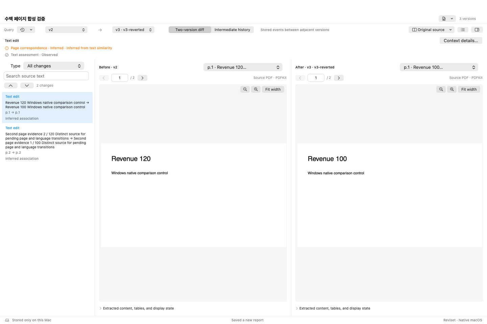
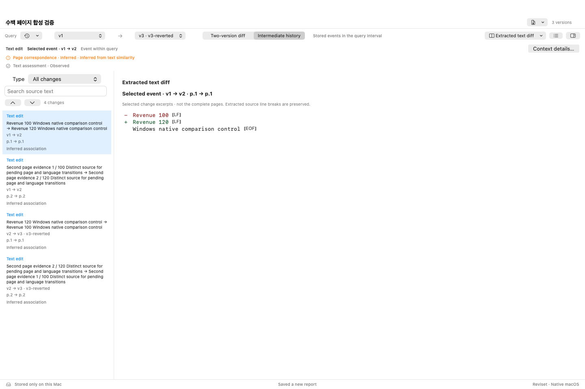
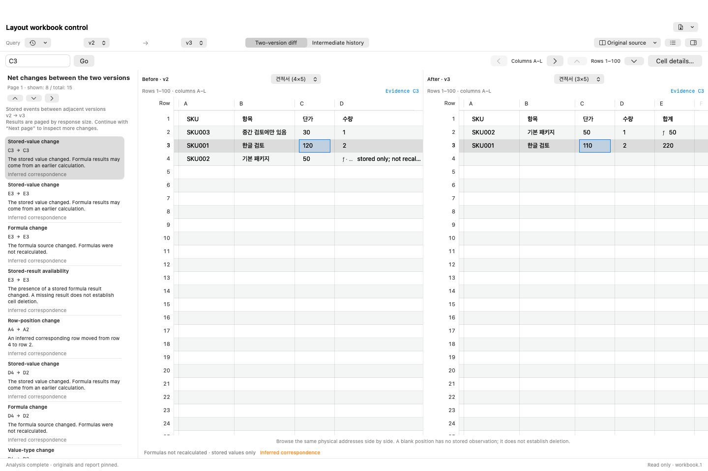
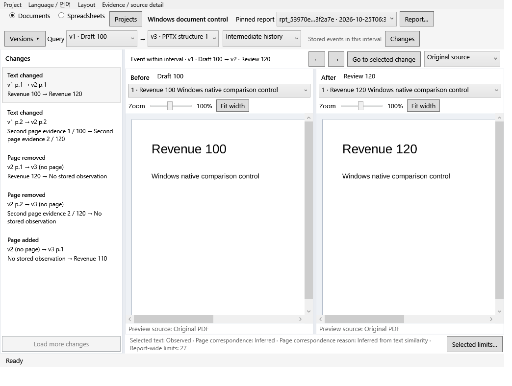

# Reviset

[English (기준 문서)](README.md) · 한국어

**원문 옆에서 문서 버전과 변경 이력을 읽습니다.**

Reviset은 PPTX/PDF 문서와 XLSX/ODS/CSV 통합 문서를 비교하는 로컬 데스크톱 앱입니다. 버전을 따라가며 변경을 선택하고 원래 페이지나 실제 셀을 나란히 확인합니다. AI 클라이언트는 읽기 전용 MCP 서버로 같은 고정 보고서를 조회할 수 있습니다. 가져오기와 분석에는 계정, API 키, 클라우드 업로드가 필요하지 않습니다.

예를 들어 `draft.pptx → review.pdf → final.pptx`에서 전망치가 `100억 → 120억 → 110억`으로 바뀐 과정을 확인합니다. 중간 이력은 처음과 마지막 비교(`100억 → 110억`)에서 보이지 않는 `120억` 단계를 보존합니다.

Apple Silicon macOS와 Windows x64의 네이티브 화면은 영어와 한국어를 지원합니다. 이전 이름은 **Docver**입니다. [이름 변경과 호환성](docs/RENAMING.md).

## 버전과 변경 읽기

1. 문서나 통합 문서 버전을 순서대로 가져옵니다. 같은 버전의 PPTX와 제공 PDF 한 쌍은 버전 항목 하나입니다.
2. 양 끝 버전을 비교하거나 중간 이력을 읽습니다. 변경을 선택하면 목록의 넓은 조회 구간을 유지하면서 해당 변경의 원문을 엽니다.
3. 원래 페이지나 실제 좌표의 셀을 읽습니다. **추출 텍스트 diff**는 한도가 있는 `−/+` 발췌를 보여 주고, **원문**은 해당 페이지나 격자로 돌아갑니다. 긴 저장 셀 필드는 명시된 이어 읽기로 확인합니다.
4. macOS에서는 **AI 도구 연결 및 내보내기**에서 고정 보고서를 내보내거나 프로젝트 MCP 설정을 복사합니다. Windows에서는 **프로젝트 → 내보내기…**로 내보내고 **프로젝트 → AI 도구 연결 · MCP 설정 복사**로 설정을 복사합니다.

가져온 버전 하나도 단독으로 읽을 수 있습니다. **새 비교 / 버전 가져오기**는 항목이 둘 이상인 별도 타임라인을 만듭니다. 가져온 버전은 스냅샷이며, Reviset이 Git 커밋을 만들거나 실제 편집자·편집 시각을 증명하지 않습니다.

통합 문서의 변경 조회, 선택한 이벤트, 실제 원문은 각각의 식별 범위를 가집니다. Windows에서는 실패한 통합 문서 조회를 재시도해도 별도로 검증된 물리 원문과 원문 판독 위치를 유지하며, 비교 방법을 바꿔도 표시 중인 물리 원문을 유지합니다. 조회 재시도는 저장해 둔 요청을 그대로 반복합니다. 원문 판독 재시도는 저장해 둔 물리 원문, 좌우 구분, 구성 요소, UTF-16 오프셋, 커서와 한도를 그대로 반복합니다. [셀 읽기와 복구](docs/SPREADSHEETS.md#cell-reading-and-recovery).

## 네이티브 작업 공간

**원문 우선**은 간결한 변경 목록 옆에 원문을 크게 표시합니다. 패널 크기·위치, 각 원문의 확대와 **맞춤**, 비교 방향을 조정하거나 이름 있는 배치를 저장합니다. 문서와 통합 문서의 설정은 별도입니다. 임시 집중 모드를 닫으면 앞선 배치를 복원하며, 고정 보고서와 조회 제어는 계속 사용할 수 있습니다. [화면 배치 안내](docs/WORKSPACE-LAYOUTS.md).



macOS 원문 v2 → v3. 간결한 변경 목록 옆에 PDFKit 페이지를 크게 표시합니다.



macOS 추출 문구. 조회 v1 → v3에서 중간 변경 v1 → v2를 선택하며 원문 줄 끝을 표시합니다.



macOS 통합 문서의 실제 셀 격자와 저장값. 대응 관계는 추정이며 수식을 재계산하지 않습니다.



Windows 원문 페이지 100%. 조회 v1 → v3과 선택한 변경 v1 → v2를 구분합니다.

네이티브 앱 내부 캡처에는 운영체제 제목 표시줄이 없습니다. 위의 네 화면은 저장소에 공개한 다섯 개의 Mac36·Windows41 원본 중에서 골랐으며, 실제 생성 소스는 각각 `158dd21`과 `13bee23`입니다. [화면 출처](docs/images/README.md)에 전체 커밋, 파일 해시와 검토 범위를 기록했습니다.

## 소스에서 빌드

Apple Silicon macOS 14 이상에서 Node 24 이상과 macOS SDK가 포함된 Xcode/Command Line Tools를 설치합니다.

```sh
git clone https://github.com/ictechgy/reviset.git
cd reviset
npm ci
REVISET_APP_NAME=Reviset-Local.app npm run mac:build
open release/Reviset-Local.app
```

macOS 빌드는 고정 LibreOffice, Node, 실행 의존성을 검증해 포함합니다. 완성된 앱 실행에 별도 Node 설치는 필요하지 않습니다. 패키징에 쓰는 Node는 시스템 dylib만 연결해야 합니다. [패키징 안내](docs/dependencies.md).

Windows x64에서는 .NET 10 SDK와 Node 24를 설치합니다.

```powershell
npm ci --ignore-scripts
npm run build
npm run windows:build
.\release\Reviset-Windows-x64\Reviset.exe
```

.NET·Node·실행 의존성을 포함한 출력 폴더 전체를 함께 둡니다. [Windows 기능과 빌드](docs/WINDOWS.md).

## AI와 내보내기

MCP는 프로젝트 범위의 내용·변경·근거를 읽기 전용으로 제공합니다. `latest`를 한 번 해석한 뒤 반환된 고정 보고서 ID를 재사용하고 `next_cursor`와 문구 이어 읽기를 끝까지 따릅니다. 앱을 옮기면 설정을 다시 복사합니다. 앱의 보고서 선택이 외부 클라이언트의 보고서를 고정하지는 않습니다. 클라우드 AI 클라이언트가 조회한 원문에는 해당 서비스의 데이터 정책이 적용됩니다. [MCP 안내](docs/MCP.md).

CLI는 `analyze`, `query`, `export`와 별도 `workbook-analyze`, `workbook-query`, `workbook-export` 명령을 제공합니다. 기본 저장소는 `.docver/`이고 `--store PATH`로 바꿉니다. [통합 문서 계약](docs/SPREADSHEETS.md).

## 지원 범위와 검증

지원 입력은 `.pptx`, `.pdf`, `.xlsx`, `.ods`와 UTF-8 쉼표 구분 CSV입니다. 이전 `.ppt`/`.xls`, 암호화 파일, ODP 직접 가져오기는 지원하지 않습니다. 가져온 원본은 복사하며 선택한 원본 파일을 덮어쓰지 않습니다. 통합 문서의 크기 한도는 [통합 문서 계약](docs/SPREADSHEETS.md)을 확인하세요.

PPTX/PDF 문구·페이지·노트·화면 관측에는 추출과 대응 관계의 한계가 남습니다. 통합 문서는 지원하는 셀 값·수식·저장 결과·기본 서식을 보존하며 수식·매크로·외부 연결을 실행하거나 재계산하지 않습니다. 누락·빈 값·구체화된 빈 셀·일부·유효하지 않은·이미 끝까지 읽은 필드를 구분합니다. OCR 불확실성, 미지원 개체, 변환 공백을 표시합니다. 보편적 OCR 정확도, 완전한 PowerPoint 렌더링과 Excel/Calc 호환성은 검증되지 않았습니다. Windows는 PDF 미리보기와 PPTX 구조를 제공하며 Apple OCR과 격리된 Office 렌더링은 사용할 수 없습니다.

개발과 검증은 진행 중입니다. [네이티브 검증 기록](docs/NATIVE-GIT-DIFF-2026-10-24.md)은 검사한 동작과 기능의 한계를 설명합니다. Mac 공증, Windows 서명, 다른 컴퓨터 설치 검증은 남아 있습니다. 이전 [공개 문서 측정](docs/PUBLIC-CORPUS-FIXES-2026-10-23.md)은 각 원래 실행 소스를 유지합니다.

개발 검사는 `npm run build`, `npm run fixtures`, `npm test`로 실행합니다. 네이티브 검사에는 각 플랫폼 도구가 필요합니다. [품질 상태](docs/QUALITY.md) · [스키마](docs/schemas/README.md) · [구조](docs/adr/003-native-macos.md).

## 라이선스

프로젝트 라이선스는 아직 선택하지 않았으며 `package.json`은 `UNLICENSED`입니다. 소스 공개가 라이선스 부여를 뜻하지 않습니다. 타사 구성 요소의 [라이선스와 고지](docs/dependencies.md)는 각각 유지됩니다.
