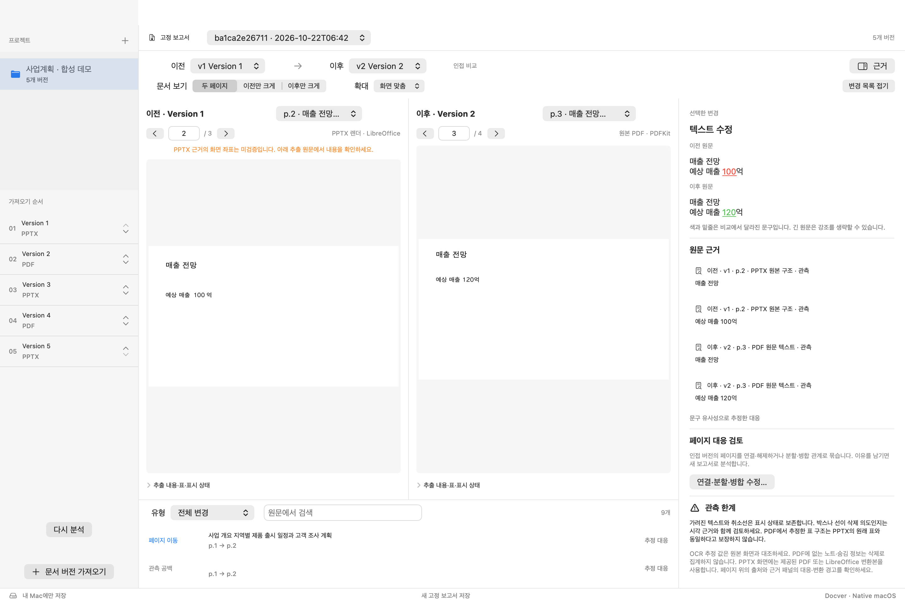
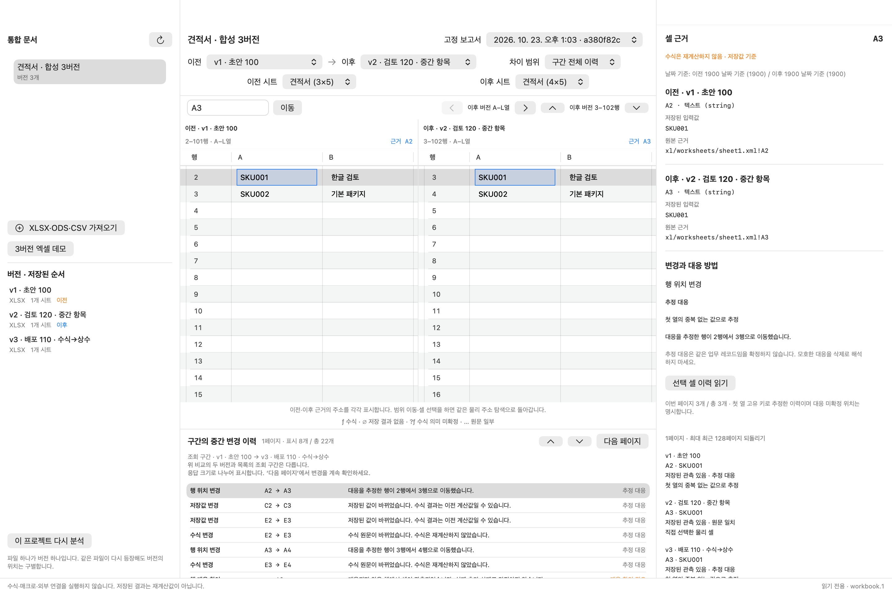

# Reviset

English (canonical) · [한국어](README.ko.md)

Formerly **Docver**. [Rename and compatibility notes](docs/RENAMING.md).

**A native macOS app for reading document version history with source evidence.**

Reviset compares versions of PPTX/PDF documents and XLSX/ODS/CSV workbooks. People inspect the originals side by side; AI clients query the same fixed reports through a read-only MCP server. Import and analysis run locally without an account, API key, or cloud upload.

For example, follow `draft.pptx → review.pdf → final.pptx` as revenue changes from `100억 → 120억 → 110억` (억 denotes 100 million). Inspect the source in each version. Beyond the first-to-last difference, the history also keeps content that was added and later removed in intermediate versions.

> **Under development and validation.** This repository provides source build instructions. The validated local app targets Apple Silicon Macs; public installer distribution, notarization, and installation on other Macs remain outstanding. A project license has not been selected. The app UI and most detailed project notes are currently in Korean.

## Screenshots

### PPTX and PDF comparison



A five-version synthetic demo showing the numeric change displayed as `100억 → 120억` and its source evidence. The left pane shows a LibreOffice conversion of a PPTX; the right pane shows the original PDF.

### Spreadsheet comparison



Inspect the actual before/after addresses, stored input values, and inferred `A2 → A3` row movement. Both screenshots were captured from the running app using synthetic demos.

## Features

| Area | What you can inspect | Interpretation limits |
| --- | --- | --- |
| PPTX and PDF | Version contents, numeric/text changes, page movement, intermediate history, visual differences | Missing format-specific information and extraction failures are distinguished from deletion. |
| Scanned and mixed PDFs | Local macOS Vision OCR, occlusion/strikethrough appearance, inferred table structure | OCR and structural associations retain uncertainty; appearance does not establish an author's deletion intent. |
| XLSX, ODS, UTF-8 CSV | Sheets, cells, formulas, saved values, basic formatting, hidden content, row movement | Formulas are not recalculated. CSV values are strings; advanced Excel/Calc objects have explicit coverage limits. |
| Human review | Link/unlink/split/merge pages; correct associations between a PPTX and a supplied PDF from the same version | User associations are reference decisions, not a rendering fidelity certificate. |
| AI and export | Fixed JSON/JSONL/Markdown reports; version contents, changes, evidence, and history through read-only MCP | Source text is data, not instructions. Follow-up queries and citations should use fixed report IDs. |

The UI uses **SwiftUI, AppKit, and PDFKit**. A shared TypeScript engine and SQLite store serve the app, CLI, and MCP. PDFKit displays PDFs; PPTX previews use bundled LibreOffice conversion or a PDF supplied for the same version.

## Build from source

### Requirements

- An Apple Silicon Mac. The build targets macOS 14 or later; the current runtime validation environment is macOS 27.0.1.
- Node.js 24 or later and npm.
- Xcode or Command Line Tools with Swift/C compilers and a macOS SDK. Current validation used the macOS 27.0 SDK.
- Internet access for npm dependencies during builds and the first LibreOffice download.

```sh
git clone https://github.com/ictechgy/reviset.git
cd reviset
npm ci
REVISET_APP_NAME=Reviset-Local.app npm run mac:build
open release/Reviset-Local.app
```

The build downloads a pinned LibreOffice version, verifies its SHA-256 and The Document Foundation (TDF) signature, and bundles it with the app. Node and production dependencies are bundled too, so **running the built app does not require a separate Node installation**. Analysis runs locally.

The Node executable used for packaging must link only system dylibs. If the build stops with `Node links a non-system dylib`, inspect `otool -L "$(command -v node)"` and use a Node executable that meets this requirement. If Vision APIs fail to compile, check the selected Xcode/SDK and its version. See the [dependency and packaging notes](docs/dependencies.md) for details.

### Use the app

1. Import documents with **문서 버전 가져오기** (`⌘O`), or open **스프레드시트 버전 비교…** (`⌘⇧O`) for spreadsheets. Arrange files in version order.
2. A document version can contain just one PPTX or PDF. Bundling a PPTX with a PDF from the same version is optional.
3. Select before/after versions and pages or sheets. For documents, switch between the **비교** (comparison) and **전체 이력** (full history) tabs. In the workbook view, choose **두 버전 순변경** (net change between two versions) or **구간 전체 이력** (full history across the range).
4. Select a change to inspect source evidence and before/after contents. Continue through long cell text; retry a failed read when needed.
5. Open **AI·내보내기** to export a fixed report or copy the project's MCP configuration.

Try the built-in **5버전 합성 데모** (five-version document demo) and **3버전 엑셀 데모** (three-version workbook demo). Document focus mode is `⌘⌥F`; the evidence panel is `⌘⌥I`.

The existing storage location is retained across the rename. Imported originals are copied into `~/Library/Application Support/Docver/library/`. The selected source files are not overwritten. Reanalysis preserves earlier fixed reports separately.

## CLI and MCP

Run these commands from the source checkout after completing the app build above.

```sh
# Generate synthetic documents, analyze them, query changes, and export
npm run fixtures
npm run cli -- analyze --manifest tests/fixtures/generated/forward/manifest.json
npm run cli -- query --project prj_forward --tool list_changes --args '{"kind":"text_modified","max_output_tokens":8000}'
npm run cli -- export --project prj_forward --out artifacts/forward
```

The CLI store defaults to `.docver/`; override it with `--store PATH`. The order of `revisions` in a document manifest defines version order. Spreadsheet commands are `workbook-analyze`, `workbook-query`, and `workbook-export`; see the [spreadsheet contract](docs/SPREADSHEETS.md).

MCP exposes project-scoped, read-only queries, with no analysis, mutation, or shell execution tools. Read specific version contents, intermediate changes, before/after values, and evidence. The app-generated configuration points to the bundled Node/server; copy it again after moving the app.

Source content retrieved through MCP is passed to the connected AI client and is subject to that client's data policies. If the client uses a cloud model, retrieved content may be sent to an external service.

For example, ask your AI client:

> Find the history of revenue forecast changes in this project. Cite the version, page or cell address, and fixed report ID for each change. Explain any OCR or inferred-association limits.

A `latest` query resolves to a fixed report ID in the response. Use that ID for subsequent queries and citations. Follow `next_cursor` and text continuations to read complete results. See the [MCP guide](docs/MCP.md) for setup and query examples.

## Support and limits

- Supported inputs: `.pptx`, `.pdf`, `.xlsx`, `.ods`, and UTF-8 comma-separated CSV. Legacy `.ppt`/`.xls` and encrypted files are outside the supported scope.
- Inputs must be directly selected regular files; final-component symlinks and special files are rejected in the app and document CLI. PPTX packages require consistent ZIP headers, sizes and CRCs, UTF-8 names, and stored or deflated members; ZIP64 and noncanonical paths are unsupported.
- PDF strikethrough annotations are observations. Flattened lines, covering boxes, and OCR associations are inferred. Occlusion or an OCR miss does not establish semantic deletion.
- PDF text-run splits and paint-order differences are checked against visible source glyphs before being called text edits. Pixel differences stay separate; exporter/font differences and actual graphic edits can remain unresolved. See [PDF exporter comparison](docs/PDF-EXPORTER-COMPARISON.md).
- PDF table extraction does not recover original PPTX cell identifiers. Vision document table structure requires macOS 26 or later; earlier supported systems provide general OCR and an unsupported-structure status.
- Formulas, macros, and external links are not executed or recalculated. Saved formula results can be absent or stale.
- Universal OCR accuracy, pixel-identical PowerPoint rendering, and complete reproduction of charts, pivots, or advanced formatting have not been achieved. Font substitutions, coverage gaps, and uncertainty remain visible.
- LibreOffice conversion is withheld for PPTX files with macros/OLE, unsupported embedded objects, or external resources. Inspect the structure view or a separately supplied PDF from the same version.
- Document limits include 512 MiB per file, 1,000 PDF pages, and 100 versions per project. Workbook limits include 64 MiB per file and report totals of 500,000 materialized cells, 100,000 blank-style ranges, 100,000 changes, and 256 MiB. These limits apply jointly with other parser/archive limits; they are not time, memory, or accuracy guarantees. See the [spreadsheet contract](docs/SPREADSHEETS.md) for details.

## Development and validation

```sh
npm run build   # TypeScript checks
npm test        # Integration suite; native checks need the macOS toolchain
```

Test preparation applies the pinned PDF.js worker patch and builds the Vision helper on supported Macs. The integration suite includes OCR, Office, and native checks and can take time.

The [official public-document test](docs/PUBLIC-CORPUS-2026-10-22.md) checks nine isolated DESNZ, NASA, NIST and W3C originals. The [repair and qualification report](docs/PUBLIC-CORPUS-FIXES-2026-10-23.md) binds each measurement to its source commit and helper. Final implementation `8d5e189` preserves 48,660 ODS values and large blank-style ranges, passes 544 MCP calls across a stored 492-page report, and passes five native-app scenarios. Earlier cold/cached engine runs and the 439-test full suite are identified separately from later scoped checks. The cached engine used 97.2% of its 4 GiB test budget; these are measured results, not general memory or accuracy guarantees. LibreOffice conversion loss and uncertain cross-version associations remain explicit limits.

The earlier [LibreOffice compatibility check](docs/LIBREOFFICE-2026-10-22.md) used real Calc and Impress saves and fixed an exported-PDF rectangle recognition issue. Results remain tied to their execution source:

| Validation | Source snapshot | Result |
| --- | --- | --- |
| Earlier full regression suite | `568fc97` | 370 passed |
| Actual Calc ODS/XLSX saves | `635a795` | 154 assertions passed |
| Affected PDF/OCR/history regressions | `f911f11` | 104 passed |
| Rectangle regressions and TypeScript checking | `f3a66bc`; TypeScript source bytes unchanged at `8364e3d` | Five passed; type checking passed |
| Packaged `release/Reviset-LibreOffice-3.app` | Clean `8364e3d9d67f2ed4ed5ffa3d58ce50e1313ab93e` | Six native launches and five MCP sessions passed; 20 captures inspected; original and legacy-report bytes preserved |

The final package also passed strict signature verification, and its exact Swift source bytes passed compilation with warnings treated as errors. Native checks covered fresh analyses and saved-report reopening for Calc, mixed PPTX/PDF history and PDF cover/strike evidence. The full suite was not rerun at the final head. Universal OCR accuracy and strict PowerPoint fidelity remain **OPEN**; OS gestures, VoiceOver, notarization, public distribution, and installation on other Macs remain outside this qualification. Direct ODP import is unsupported; save as PPTX or export PDF in Impress first.

Most detailed documents below are in Korean.

| Document | Contents |
| --- | --- |
| [Official public-document results](docs/PUBLIC-CORPUS-2026-10-22.md) | Real-data results, security isolation, confirmed limits and exact source scope |
| [Quality status](docs/QUALITY.md) | Validation results and remaining accuracy/distribution gates |
| [LibreOffice compatibility and repair](docs/LIBREOFFICE-2026-10-22.md) | Actual Calc/Impress saves, PDF covers, final app and historical-report verification |
| [Earlier overall repair review](docs/REVIEW-2026-10-22.md) | Input/archive boundaries, commit recovery, native fixes, and snapshot-bound review/package evidence |
| [Earlier workbook improvements and validation](docs/WORKBOOK-RECOVERY-2026-10-22.md) | Read recovery, cell provenance, UI changes, and scoped review evidence |
| [MCP guide](docs/MCP.md) | AI setup, query order, and output budgets |
| [Spreadsheet contract](docs/SPREADSHEETS.md) | Formats, formula/cell semantics, and processing limits |
| [Schemas](docs/schemas/README.md) | Fixed reports and query responses |
| [Native architecture](docs/adr/003-native-macos.md) | App and shared engine design |
| [Dependencies](docs/dependencies.md) | Packaging and third-party components |

Detailed raw records may refer to local validation paths. `.omx/`, `release/`, `output/`, generated fixtures, and original-document stores are excluded from the GitHub source repository. Design and implementation history are in [DESIGN.md](DESIGN.md) and [PROGRESS.md](PROGRESS.md).

## License

A project license has not been selected; `package.json` declares `UNLICENSED`. A public repository should not be interpreted as an open-source license grant. Third-party components retain their respective licenses and notices; see the [dependency notes](docs/dependencies.md).
