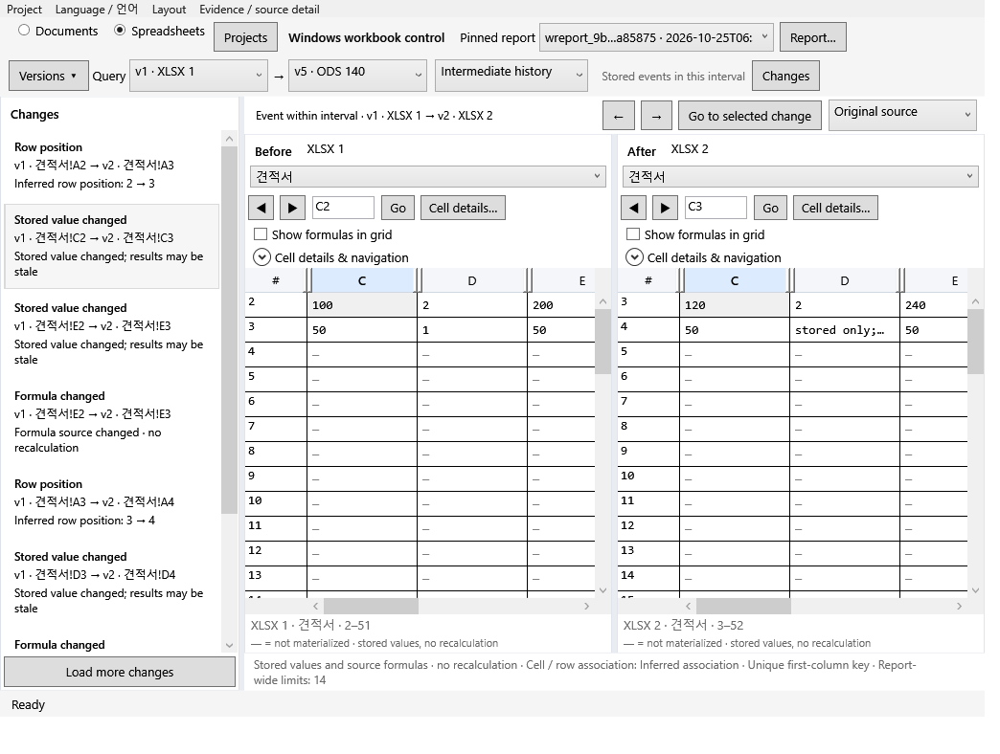

# Windows native application

Reviset's Windows application uses WPF native controls and the same local Node engine as the macOS app. It requires Windows 10/11 x64. The portable package includes .NET and Node; no Office subscription, browser shell, or model account is required. Source files remain local.

## Build

On Windows x64, install the official .NET 10 SDK and Node 24, then run:

```powershell
npm ci --ignore-scripts
npm run build
npm run windows:build
```

The output is `release/Reviset-Windows-x64/Reviset.exe`. Keep the entire folder together: the native executable uses its adjacent `runtime/node.exe`, `backend`, and `node_modules`. Build metadata records the exact source commit, dirty state, official Node runtime URL/hash and patched PDF.js fingerprint. Node 24.22.1 is pinned by the packager and verified against its official SHA-256 before bundling. The package is not Authenticode signed.

The [Windows workflow](../.github/workflows/windows.yml) builds on an actual Windows runner, tests portable document/workbook processing, runs the packaged WPF smoke and uploads the portable ZIP with native evidence. A macOS cross-build is a compiler check, not evidence that the Windows application ran.

## Native app screenshots


Windows source pages at 100%: query v1 → v3 and selected event v1 → v2 remain distinct.



Windows native workbook grids for the selected v1 → v2 event within the wider v1 → v5 query.

## Platform capabilities

| Capability | Windows implementation |
| --- | --- |
| PDF text and appearance observations | Shared PDF.js extraction, including explicit visibility uncertainty |
| PDF page display | Bounded PNG preview from a verified asset selected by fixed report/page identity |
| PPTX text, tables, shapes and notes | Shared original-structure extraction |
| XLSX, ODS and CSV | Shared sparse observations, formulas and stored values; no recalculation |
| JSON/JSONL/Markdown and read-only MCP | Shared fixed-report services |
| Apple Vision OCR | Unavailable on Windows; retained observations from existing reports remain data |
| Confined LibreOffice/ONLYOFFICE rendering | Unavailable on Windows until a qualified Windows confinement adapter exists |

PPTX structural content is labelled separately from an original page rendering. Image-only PDFs need an OCR adapter to obtain text; a page preview is not OCR. Windows does not automatically run a system Office installation without confinement. Conversion/OCR gaps remain explicit and are not reported as deletion or successful extraction.

## Working with versions

Import one PDF or PPTX per document version, or pair one PDF with one PPTX from the same version. For workbooks, select XLSX, ODS or UTF-8 comma-separated CSV. Name and order the versions before import. Reanalysis creates a new fixed report while preserving earlier reports.

The default comparison is the latest version against its predecessor. Choose an explicit query interval or select an earlier version from the version list to compare it with its predecessor. The first version or equal endpoints can be read alone. The app distinguishes several imported versions with equal endpoints from an actual one-version import. In the latter case, a visible **New comparison / Import versions** action starts a new timeline containing at least two version entries; it does not append to the current immutable report. Irrelevant change filters/pagers are hidden and the mounted pane is labelled source reading. The document list labels its provenance: neighboring two-version choices show canonical stored events, wider Net choices show computed endpoint changes, and History shows stored events in the interval; selecting an intermediate event changes the displayed sources and retains the wider query. Previous/next change actions and a bounded text-diff view support review beside the original visual source. Manual source browsing retains the owned paged change list and interval; **Return to selected change** restores its event sources. Sources browsed manually do not acquire the selected event's semantic edit styling. Coverage gaps, appearance/strikethrough/occlusion observations and unavailable fields remain neutral. Missing, empty, blank, partial, invalid and already-read cell fields remain distinct; formula source and saved results have separate eligibility and continuation state. Formulas are not recalculated.

Use query endpoints or the version log to choose versions. Source headers show the displayed version and sheet. These choices start with valid sheets in the chosen versions; an absent sheet remains neutral while the opposite grid can stay readable.

Document API `range_net` always recomputes endpoint changes, even for neighbors, and can differ from stored UI events in split/merge kinds or manually unlinked correspondence. Workbook `range_net` instead uses stored events for adjacent versions. Recover document UI stored IDs using the fixed report and containing interval with `list_changes(mode:history)`, then `get_change` without mode. See the [MCP recipe](MCP.md#recovering-the-document-uis-stored-change-ids).

Windows text comparison allows 16,384 UTF-16 units and 300 lines per side; macOS intentionally uses 4,096 units and 128 lines. Complete workbook cell fields beyond the comparison budget stay readable neutrally; document overlays disclose bounded event excerpts and retain the original-source/evidence route. Per-line source boundaries remain distinct from concatenated text. Current Windows static captures do not establish visible LF/EOF marker parity with macOS. Any visible boundary markers are display annotations; stored raw text, bounded-preview scope and full continuation routes remain exact. Grid tooltips label bounded previews and point to selected-cell/source continuation for the full field. Materialized blanks, missing cells, absent formulas and missing saved results retain distinct captions; a missing cell is not missing sheet metadata. Generated summaries are localized while raw report descriptions and arbitrary authored strings remain literal.

The compact report selector remains visible in Focus. Import, analysis, export and AI-tool connection are available from the native project menu; cancellation appears during work. Workbooks provide physical cell-address navigation and stored formula/value evidence. Exports use the selected fixed report. The copied read-only MCP configuration is project-scoped; clients choose and reuse a fixed report ID. Source text and diagnostic codes remain verbatim when the interface language changes. Manual page/bundle relation editing remains in the macOS UI.

## Reading and recovering source evidence

Query-only failure preserves independently verified physical sources, selectors, native hosts, rows, scroll positions and separately owned raw readers. Retry repeats the failed reset or append/cursor query with its fixed project, report, interval, mode and generation; failed rows do not establish event membership. Raw-reader Retry repeats its captured physical source, side, component, UTF-16 offset, cursor and limit rather than restarting a failed continuation. Successful query recovery does not automatically select an event or relocate retained sources.

Switching Net/History retires old event styling while retaining a separately valid physical reader and its continuation. Only initial report loading or an explicit new workbook version pair may select the first eligible linked cell change after a successful query. Method changes, fallback, retries, pagination, passive refresh, locale/layout changes and manual browsing retain displayed physical sources; manual browsing cancels pending initial focus.

Reference-PDF previews use the displayed PDF's physical geometry. The primary PPTX retains its OOXML EMU dimensions and normal point conversion; a supplied PDF is not sized from the slide merely because it is associated with it. Source headers refresh on event navigation, restoration, occurrence changes and clearing. A legitimately absent source is a neutral terminal state, distinct from loading, failure and a ready available source.

Selecting an event can fail to read its source without invalidating an otherwise valid paged query. The list, interval, mode and cursor remain owned; retry targets that intended event/report/membership. Old anchors cannot describe a failed new target, and superseded errors cannot install retry. A failed query still uses its separate recovery route.

Visible **Cell details** opens the focused physical cell's bounded reader and continuations. The reader keeps its physical owner separate from the change-list interval and identifies its side, version, sheet and cell address. Global UTF-16 offset and Next availability describe the reader rather than a selected event; stored text remains verbatim. Sheet metadata has metadata captions without missing-cell rows; selected null cell observations do not inherit old coordinates. Unknown types remain neutral. Text-mode navigation explicitly returns to original-source browsing, and single-source warnings/footer describe one source.

Startup recovery failure keeps writer actions disabled until explicit recovery succeeds. The library lock remains enforced before window creation. Range inputs must be validated; unavailable range metadata or omitted page lists cannot be presented as complete observations. Workbook AI help describes its own fixed-report/query contract. Recognized generated ISO-8601 summary patterns are localized; unknown authored strings and raw report descriptions remain literal. Empty import states retain the visible new-comparison/import action creating a new timeline.

Metadata-only sheet events show metadata without physical-cell rows or paging. Selecting a physical address returns to cell reading. Source-page captions stay neutral until the selected event establishes source absence.

## Layouts and data

Use **Layout → Source first** for Changes on the left and a large source area with projects/evidence closed. Fresh preferences and Reset Layout use this arrangement; saved preferences remain intact. Resize, dock or hide panels, reverse the comparison direction, or save a named layout separately for documents and workbooks. Document Focus temporarily expands the source and restores the retained panel arrangement when closed. In narrow windows, Changes and Evidence can move below the sources without replacing saved preferences, and visible projects remain accessible. The report and query controls remain available. Display settings leave source files, fixed reports and MCP data unchanged. See [workspace customization](WORKSPACE-LAYOUTS.md) for Focus, reset, shortcuts and saved-layout behavior.

Initial grid widths remain stable while observations load or results are empty; explicit column resizing retains the chosen width for that source. Rows follow physical coordinates rather than header sorting. Each pane has independent zoom and **Fit** controls. The workspace title is the literal project name; generated availability labels are localized while metadata JSON remains neutral.

The app library and display preferences live under the user's local application data. A native exclusive library lock prevents two application writers from using the same library. Backend requests use UTF-8 pipes and argument arrays without shell interpolation. A Windows Job Object manages process lifetime; it does not provide file or network confinement. The Windows regular-file check is not an atomic `O_NOFOLLOW` guarantee. Page-preview requests cannot choose arbitrary file paths; original assets are hash-verified before rendering.

## Large documents and workbooks

The native workbook grid requests 50 rows by up to eight columns and uses row/column virtualization. PDF display uses bounded previews for the selected pages. These bounds control view payloads; analysis and the first fixed-report query can still load substantial report data. Paging does not make processing constant-memory.

Document/parser limits are admission limits, not time or memory guarantees. The earlier Mac 492-page cached analysis used 97.2% of its 4 GiB test budget at its recorded source; see the [public-corpus measurements](PUBLIC-CORPUS-FIXES-2026-10-23.md). This update does not add an equivalent Windows large-corpus performance qualification.

## Known issues and qualification

The current packaged evidence is [Windows41 run 40169227816](https://github.com/ictechgy/reviset/actions/runs/40169227816), produced from `13bee235b063b66e0668ccc3c24f599e9bc1acc6`. It covers programmatic WPF actions and rendered native controls, with no OS mouse/keyboard or screen-reader automation.

If Reorder saves draft order and its refresh then fails or is cancelled, a generic failure and stale draft summary can remain. Reopening refreshes draft metadata while fixed reports remain unchanged. This failure-reporting follow-up remains open.

See the [native qualification record](NATIVE-GIT-DIFF-2026-10-24.md) for package identities, tested behavior, current review scope and capability limits.
