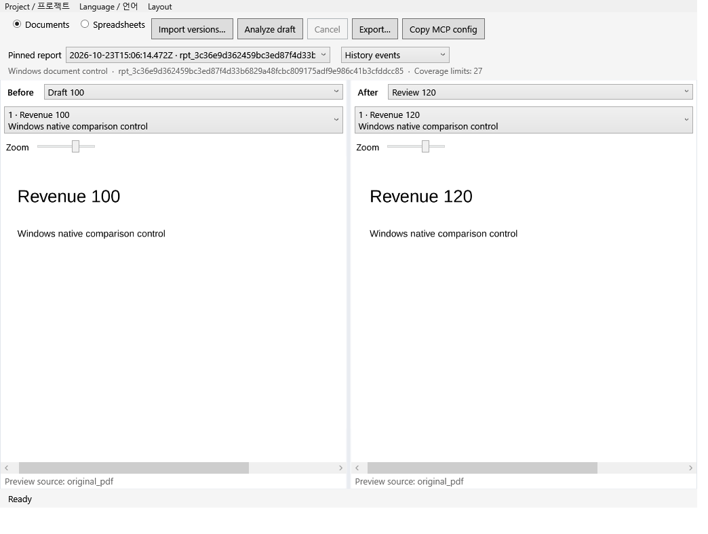
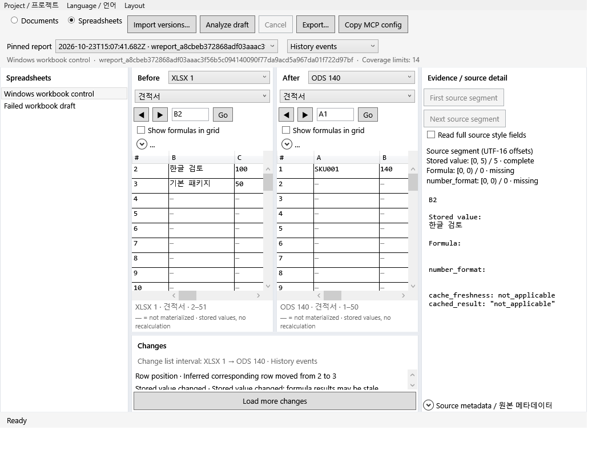

# Windows native application

Reviset's Windows application uses WPF native controls and the same local Node engine as the macOS app. It requires Windows 10/11 x64. The portable package includes .NET and Node; no Office subscription, browser shell, or model account is required. Source files remain local.

## Build

On Windows x64, install the official .NET 10 SDK and Node 24, then run:

```powershell
npm ci --ignore-scripts
npm run build
npm run windows:build
```

The output is `release/Reviset-Windows-x64/Reviset.exe`. Keep the entire folder together: the native executable uses its adjacent `runtime/node.exe`, `backend`, and `node_modules`. Build metadata records the exact source commit, dirty state, official Node runtime URL/hash and patched PDF.js fingerprint. Node 24.22.1 is pinned by the packager and verified against its official SHA-256 before bundling. The package is not Authenticode signed.

The [Windows workflow](../.github/workflows/windows.yml) builds on an actual Windows runner, tests portable document/workbook processing, runs the packaged WPF smoke and uploads the portable ZIP with native evidence. A macOS cross-build is a compiler check, not evidence that the Windows application ran.

## Actual app screenshots



Document Focus gives the original PDF pages more room. This is an unmodified client-content capture from the clean `29f3a8ad` package; OS title chrome is outside the capture.



The workbook view shows physical row/column addresses, stored values and selected cell evidence. Korean source text remains verbatim in the English interface. The two panes can inspect independently selected source cells. Both original captures retain the actual small-runner-window extent, including the black bottom margin.

## Platform capabilities

| Capability | Windows implementation |
| --- | --- |
| PDF text and appearance observations | Shared PDF.js extraction, including explicit visibility uncertainty |
| PDF page display | Bounded PNG preview from a verified asset selected by fixed report/page identity |
| PPTX text, tables, shapes and notes | Shared original-structure extraction |
| XLSX, ODS and CSV | Shared sparse observations, formulas and stored values; no recalculation |
| JSON/JSONL/Markdown and read-only MCP | Shared fixed-report services |
| Apple Vision OCR | Unavailable on Windows; retained observations from existing reports remain data |
| Confined LibreOffice/ONLYOFFICE rendering | Unavailable on Windows until a qualified Windows confinement adapter exists |

PPTX structural content is labelled separately from an original page rendering. Image-only PDFs need an OCR adapter to obtain text; a page preview is not OCR. Windows does not automatically run a system Office installation without confinement. Conversion/OCR gaps remain explicit and are not reported as deletion or successful extraction.

## Working with versions

Import one PDF or PPTX per document version, or pair one PDF with one PPTX from the same version. For workbooks, select XLSX, ODS or UTF-8 comma-separated CSV. Name and order the versions before import. Reanalysis creates a new fixed report while preserving earlier reports.

Choose before/after versions, then select a page or sheet and a change. The change-list mode switches between endpoint net changes and intermediate history for the selected interval. Workbooks provide physical cell-address navigation and stored formula/value evidence. Exports use the selected fixed report. The copied read-only MCP configuration is project-scoped; clients choose and reuse a fixed report ID. Source text and diagnostic codes remain verbatim when the interface language changes. Manual page/bundle relation editing remains in the macOS UI.

## Layouts and data

Both native workspaces provide panel resizing, docking, visibility, built-in layouts and named saved layouts. Choose **Layout** to start with Balanced, Document Focus or Review, move Changes below/left/right, place evidence on either side, change comparison direction, or save a named layout. Document and workbook preferences are separate. A visible project panel stays accessible in narrow windows; hide it explicitly when you want more source space. Reset Layout restores the default arrangement without deleting a project. Display changes leave source files, fixed reports and MCP data unchanged. See [workspace customization](WORKSPACE-LAYOUTS.md).

The app library and display preferences live under the user's local application data. A native exclusive library lock prevents two application writers from using the same library. Backend requests use UTF-8 pipes and argument arrays without shell interpolation. Page-preview requests cannot choose arbitrary file paths; original assets are hash-verified before rendering.

## Large documents and workbooks

The native workbook grid requests 50 rows by up to eight columns and uses row/column virtualization. PDF display uses bounded previews for the selected pages. These bounds control view payloads; analysis and the first fixed-report query can still load substantial report data. Paging does not make processing constant-memory.

Document/parser limits are admission limits, not time or memory guarantees. The earlier Mac 492-page cached analysis used 97.2% of its 4 GiB test budget at its recorded source; see the [public-corpus measurements](PUBLIC-CORPUS-FIXES-2026-10-23.md). This update does not add an equivalent Windows large-corpus performance qualification.

## Implementation and qualification

The clean `29f3a8ad58698bdd5f410efa786ed39022512756` package passed [actual Windows workflow 39975028777](https://github.com/ictechgy/reviset/actions/runs/39975028777): 95 portable/boundary tests passed, zero failed and four POSIX-only tests skipped (99 total), plus 24 preference checks and 63 production WPF window/model/action checks. These include six workbook layouts, physical row geometry at feasible viewports, horizontal scrolling where available, separate physical stored-cell queries, change-mode synchronization and invalid reversed-range handling in English/Korean. A production Reorder check uses three distinct reports and retains the older, middle report selection, source pages/event scope, selected net interval, 200% zoom and both manual X/Y viewports. All three fixed report bodies and the report list remain unchanged.

The app-generated MCP configurations passed using bundled Node: 29 read-only tools, five document page items, 72 workbook cell items and denial of foreign-project scope. All 18 original Windows PNGs were inspected directly. The portable ZIP is 132,322,986 bytes; SHA-256 `38d087bb2a63273053672488d6612947b3190e1d9aaf2ed86e01d55dc0b648a9`.

Native code review at `29f3a8ad` returned COMMENT with zero actionable findings; architecture returned WATCH without a BLOCK, retaining the scaling caveat above. Claude, Devin and Grok approved the tested `29f3a8ad` source. The earlier Claude 18-image Windows closure returned COMMENT at `e443a440`; it is not a review of the current images. Narrow change-list/source space, clipped provenance captions and partial column headers remain nonblocking polish. If Reorder writes the draft order but the following view refresh/restoration fails or is cancelled, a generic failure and stale draft summary can remain. Fixed reports stay unchanged; reopening the project refreshes its draft metadata. This failure-reporting followup remains open. Runtime checks exercise production WPF actions and RenderTargetBitmap captures, not OS mouse/keyboard or screen-reader automation.

The Mac and Windows apps were both built and run at the same clean `29f3a8ad` source. See the [native workspace qualification](NATIVE-WORKSPACES-2026-10-23.md) for their separate artifacts, the older full-suite baseline and final review state. Historical runs retain their original source commits.

Implementation references: [Microsoft WPF/.NET 10](https://learn.microsoft.com/en-us/dotnet/desktop/wpf/whats-new/net100), [Desktop SDK project properties](https://learn.microsoft.com/en-us/dotnet/core/project-sdk/msbuild-props-desktop), [cross-platform Windows targeting](https://learn.microsoft.com/en-us/dotnet/core/tools/sdk-errors/netsdk1100), and [official Node release files](https://nodejs.org/dist/v24.22.1/).
